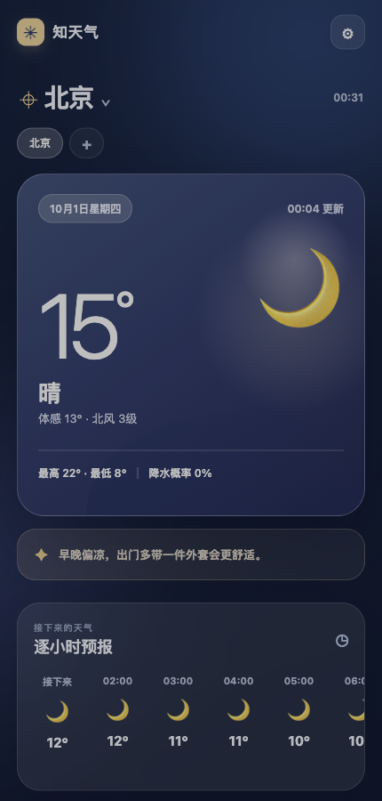
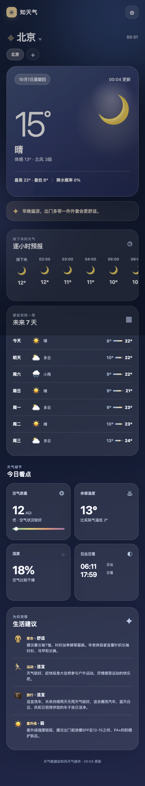

# 知天气 · 移动天气工作台

为手机设计的天气页面，帮助查看当前城市的天气、未来变化和出行建议。对应原服务器的 8445 端口。

## 界面截图

截图使用北京作为示例城市；天气数值会随时间变化，不包含个人定位数据。

| 当前天气与逐小时预报 | 完整预报与生活建议 |
| --- | --- |
|  |  |

## 功能

- **城市切换**：搜索城市并保存常用城市；只有在用户主动点击定位时才请求浏览器位置权限。
- **实时天气**：显示当前温度、天气状况、体感温度、风力、最高最低温和降水概率，并标注更新时间。
- **天气趋势**：提供逐小时与未来七天预报，便于安排近期活动。
- **今日指标**：展示空气质量、体感温度、湿度、日出日落等信息。
- **生活建议与预警**：结合天气数据给出穿衣、运动、出行等建议；有天气预警时显示预警内容。
- **个人偏好**：切换摄氏度或华氏度及页面外观，偏好保存在当前浏览器。
- **手机主屏幕**：提供 Web App 图标与静态页面离线缓存；实时天气数据仍需联网。

## 本地运行

需要 Node.js 20 或更新版本。应用直接使用 Node.js 标准能力，无需安装第三方依赖。服务端需要和风天气 API 主机和密钥，通过环境变量提供：

    QW_API_HOST=your-api-host QW_API_KEY=your-api-key HOST=127.0.0.1 PORT=3105 node server.mjs

请勿将真实密钥写进源码或提交环境文件。网页通过本地服务端请求天气数据，浏览器不直接持有和风天气密钥。

仓库只包含应用源码和静态资源，不包含线上环境文件、Nginx 配置或用户数据。天气数据来源：[和风天气](https://www.qweather.com/)。
